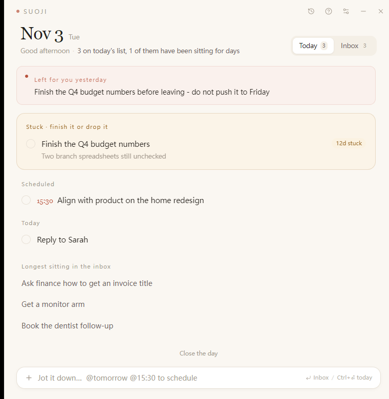
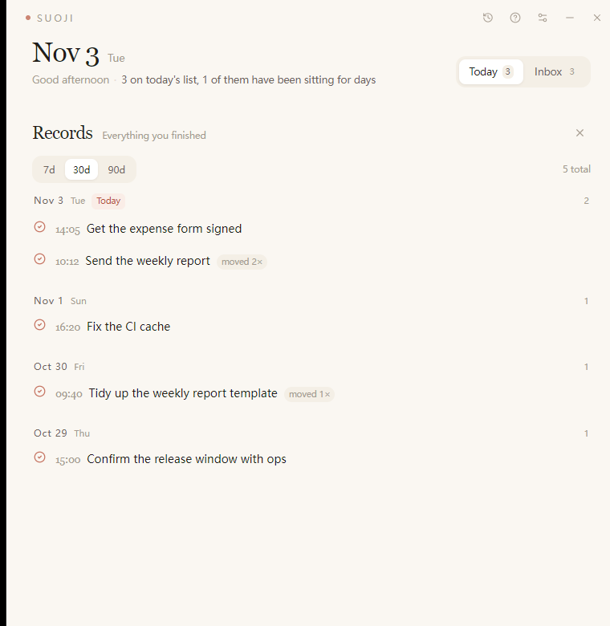

<div align="center">

  <h1>Suoji · 琐记</h1>

  <p><strong>A tiny desktop app for one job: making sure small tasks don't silently slip away.</strong></p>
  <p>Local-first · no account · no network · a single SQLite file</p>

  <p>
    <a href="https://github.com/Leecoin49/suoji/actions/workflows/ci.yml"></a>
    <a href="https://github.com/Leecoin49/suoji/releases"></a>
    
    
    
    
  </p>

  <p>
    English | <a href="README.zh-CN.md">中文</a>
  </p>

  <p>
    
    
  </p>

</div>

## Why Suoji?

Most todo apps fail at the same two moments: the ten seconds when you think of
something (so you don't write it down), and the evening when you have to rebuild
yesterday in your head.

Suoji is built around those two moments only. It is deliberately small: every
feature has to make **capture faster** or **the daily review cheaper**, or it
doesn't get in.

The one idea that isn't in ordinary todo apps: **nothing slides away quietly**.
Whatever you didn't finish rolls to the next day automatically and leaves a mark -
how many times it was pushed (`moved 5x`), how long it has been hanging
(`held 12d`). Things that are quietly rotting surface on their own, instead of
waiting for you to remember to look for them.

## Features

### Capture in one line

Press `Ctrl+Alt+Space` anywhere, type one line, hit `Enter`. No project, no tag, no
date picker - it lands in the inbox by default.

A plain-text mini syntax handles the rest (English and Chinese tokens both work):

| You type | Result |
| --- | --- |
| `Send the weekly report @tomorrow` | lands on tomorrow |
| `Align with product @15:30` | today at 15:30, in the timed group |
| `Expense form @fri` | that week's Friday |
| `@10-25` `@10/25` `@day after` | any explicit date works |
| `Reply to Sarah!` | trailing `!` = do it today |

### The day reschedules itself

- Unfinished tasks roll to the new day at midnight - a background action, not a chore.
- Each roll increments a **roll counter**; `first_seen_date` gives the **held days** badge.
- The morning view shows "the few things for today", not an infinite backlog.

### Two gentle reminders, one honest close-out

- A morning notice and an evening notice at times you choose (defaults 09:00 / 18:30).
- Each notice only fires within a 2-hour window after its scheduled time, so a
  missed reminder doesn't replay the whole day at 23:00.
- Evening close-out: walk the leftovers one by one - tomorrow / inbox / drop - then
  leave one line for tomorrow (the **note for tomorrow**), which greets you at the
  top of the next day.

### Nothing disappears when you finish it

- Today's completed items stay visible under a collapsible section.
- The history sheet replays any of the last 7 / 30 / 90 days grouped by day, with
  completion time, notes, and how many times it had been pushed.
- Ticked by mistake? Send it back to today in one click.

### Bilingual, built in

- The whole UI ships in **English and Chinese**; switch it in Settings, the tray
  menu and reminder text follow along immediately.
- Every string lives in `src/lib/i18n.ts` (UI) and `src-tauri/src/i18n.rs` (tray,
  notifications), so adding a language is a data change, not a refactor.

### Local by construction

- No account, no server, no telemetry. The only network call is the update check, and you can turn it off.
- One SQLite file: `%APPDATA%\com.tool.suoji\suoji.db` - copy it, that's your backup.
- Closing the window hides it to the tray; reminders keep working. Quit from the tray menu.
- Built-in help page (the `?` button), opened automatically on first launch.

## Install

Grab the latest from [Releases](https://github.com/Leecoin49/suoji/releases). Six
builds, the same platform matrix as dbx:

| Platform | Files |
| --- | --- |
| Windows 10/11 x64 | `Suoji_<version>_x64-setup.exe` (per-user, no admin), `Suoji_<version>_x64-portable.exe` |
| Windows 10/11 arm64 | `Suoji_<version>_arm64-setup.exe`, `Suoji_<version>_arm64-portable.exe` |
| macOS 10.15+ Apple Silicon | `Suoji_<version>_arm64.dmg` |
| macOS 10.15+ Intel | `Suoji_<version>_x64.dmg` |
| Linux x64 | `Suoji_<version>_amd64.AppImage`, `Suoji_<version>_amd64.deb` |
| Linux arm64 | `Suoji_<version>_arm64.AppImage`, `Suoji_<version>_arm64.deb` |

On Windows the app installs as 琐记 (Suoji). WebView2 ships with Windows 10/11; the
Linux builds need `libwebkit2gtk-4.1` from the distribution.
## Updates

The app has an update center of its own: **Settings → Updates**, or the download
icon in the title bar.

- It checks once a day (configurable) and quietly downloads in the background.
- A small dot on the title-bar icon means a build is ready; nothing installs
  until you press **Restart and update**.
- Release notes are shown in the update center; a version you do not want can be
  skipped permanently.
- Every release is signed with minisign, and the installed build verifies the
  signature before running the installer — a tampered download is refused.

The manifest the app reads is `latest.json` on the newest release, built by
`.github/workflows/release.yml`. Endpoints and the public key live in
`src-tauri/tauri.conf.json` under `plugins.updater`.

## Getting Started

### Prerequisites

| Tool | Version |
| --- | --- |
| Node.js | >= 22 (see `.nvmrc`) |
| pnpm | 8+ (`corepack enable` works) |
| Rust | >= 1.88 (stable) |
| VS Build Tools | 2019+, "Desktop development with C++" |
| WebView2 | any recent |

### Development

```bash
pnpm install
make dev          # or: pnpm tauri dev
```

`pnpm dev` starts only the Vite frontend. The app is single-instance: close a
running copy, or temporarily change `identifier` in `src-tauri/tauri.conf.json`
to run both side by side (each identifier gets its own database).

### Build

```bash
make build        # type-check + frontend build
make package      # full desktop build + NSIS installer
```

Artifacts land in `src-tauri/target/release/` and
`src-tauri/target/release/bundle/<nsis|dmg|deb|appimage>/`. Pass a target to
build the bundles of another platform: `pnpm tauri build --target aarch64-apple-darwin`.

Signing an update requires the private key; without it the build still works but
produces no updater artifact (`*.sig`) and no `latest.json` for CI:

```bash
export TAURI_SIGNING_PRIVATE_KEY=/path/to/updater.key   # or the key string
export TAURI_SIGNING_PRIVATE_KEY_PASSWORD=              # empty for a passwordless key
make package
```

> [!NOTE]
> The NSIS bundler downloads its toolchain from GitHub on first run. Behind a
> firewall, set `HTTPS_PROXY` / `HTTP_PROXY` before `make package`.

### Checks

```bash
make check        # vue-tsc + cargo fmt --check + cargo clippy -D warnings
make fmt          # format Rust sources
```

### Demo data for screenshots

```powershell
# with the app closed, seed a throwaway profile (identifier com.tool.suoji.preview)
sqlite3 "$env:APPDATA\com.tool.suoji\suoji.db" ".read scripts/demo-seed.sql"
```

`scripts/demo-seed.sql` holds English task text, `scripts/demo-seed.zh.sql` the
Chinese one, so screenshots can be taken in either language.

`scripts/screenshot.ps1 -Pid2 <pid> -Out day.png` captures a window off-screen
(`PrintWindow`), so it never steals focus while you work.

## Where your data lives

```
%APPDATA%\com.tool.suoji\suoji.db
```

One file, standard SQLite. Copy it to back up; delete it to start over. Nothing is
uploaded anywhere: the only request the app makes is the update check (switched off
in a click), and no task content is ever part of it.

## Tech Stack

| Layer | Choice |
| --- | --- |
| Shell | Tauri 2 (Rust) |
| UI | Vue 3 + TypeScript + Vite |
| Styles | Tailwind CSS 4 |
| State | Pinia |
| Storage | SQLite via rusqlite (bundled) |
| i18n | Hand-rolled `ref` + dictionaries, no runtime i18n library |
| Updates | `tauri-plugin-updater` with minisign signatures, manifest on GitHub Releases |
| Icons | lucide-vue-next |
| Dates | dayjs |

## Project Structure

```
src/                    Vue frontend
  components/           TitleBar, CaptureBar, TaskRow + close-out/history/help/settings/update sheets
  lib/api.ts            typed wrappers around every Tauri command
  lib/i18n.ts           every user-visible string, zh + en
  lib/parse.ts          the one-line syntax parser
  stores/day.ts         Pinia store
  stores/update.ts      update center state: check, download, install, skip
src-tauri/src/
  lib.rs                plugins, tray, global hotkey, autostart, command registration
  commands.rs           the entire IPC surface
  i18n.rs               tray and notification strings
  ui.rs                 tray menu and locale switching
  db.rs                 connection, schema, meta/settings
  model.rs              serde types shared with the frontend
  schedule.rs           30s tick: midnight rollover + the two daily notices
scripts/                icon generation, screenshot helper, demo seeds
docs/screenshots/       README images
```

## Documentation

- [`CONTRIBUTING.md`](CONTRIBUTING.md) · [`CONTRIBUTING.zh-CN.md`](CONTRIBUTING.zh-CN.md)
- [`SECURITY.md`](SECURITY.md)
- In-app help: the `?` button in the title bar (source: `src/lib/i18n.ts` → `helpContent`)

## Contributing

Issues and pull requests are welcome - please read
[`CONTRIBUTING.md`](CONTRIBUTING.md) first, and keep the diff focused on one thing.
Commit messages in English, please.

## License

[Apache License 2.0](LICENSE). See [`NOTICE`](NOTICE) for bundled open-source components.
