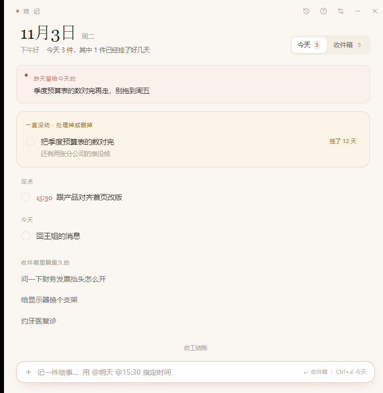
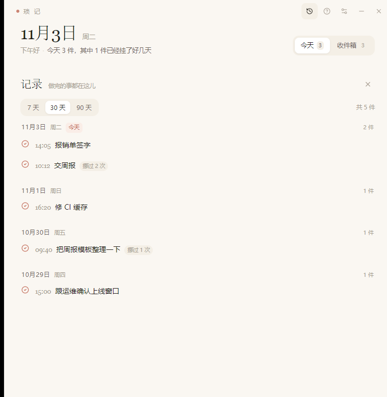

<div align="center">

  <h1>琐记 · Suoji</h1>

  <p><strong>只干一件事的桌面小应用：让琐事不会无声溜走。</strong></p>
  <p>本地优先 · 无账号 · 无联网 · 一个 SQLite 文件</p>

  <p>
    <a href="https://github.com/Leecoin49/suoji/actions/workflows/ci.yml"></a>
    <a href="https://github.com/Leecoin49/suoji/releases"></a>
    
    
    
    
  </p>

  <p>
    <a href="README.md">English</a> | 中文
  </p>

  <p>
    
    
  </p>

</div>

## 为什么做它

大多数待办应用都在同两个瞬间失效：想到一件事的那十秒（干脆不记了），
以及晚上要把昨天在脑子里重新过一遍的时候。

琐记只围绕这两个瞬间。它刻意做小：每个功能要么让**记录更快**，
要么让**每天回顾更省事**，否则就不进。

普通待办里没有的那一件事：**没有什么会悄悄溜走**。没做完的每天零点自动顺延，
并且留下痕迹——被往后挪了几次（`挪过 5 次`）、已经挂了多久（`挂了 12 天`）。
默默烂掉的事会自己浮上来，而不是等你想起来去找它。

## 功能

### 一句话记下来

任何地方按 `Ctrl+Alt+Space` 唤出，敲一行，回车。没有项目、没有标签、没有日期选择器——
默认进收件箱。

剩下的事交给一套纯文本小语法（中英文都认）：

| 你写 | 结果 |
| --- | --- |
| `交周报 @明天` | 落到明天 |
| `跟产品对齐 @15:30` | 今天 15:30，单独一组 |
| `补报销单 @周五` | 那周的周五 |
| `@10-25` `@10/25` `@后天` | 指定日期都认 |
| `回王姐消息!` | 结尾感叹号 = 今天就做 |

### 日子自己会顺延

- 没做完的，零点自动滚到新的一天——是后台动作，不是你要做的家务。
- 每次顺延累加**挪动次数**；`first_seen_date` 算出**挂了几天**的徽标。
- 早上给的是「今天该做的几件」，不是一屏看不到头的待办。

### 两次轻提醒，一次收工结账

- 早晚各一次提醒，时间自己定（默认 09:00 / 18:30）。
- 提醒只在设定时间之后的 2 小时内触发，错过的不会在深夜补发。
- 傍晚收工：把剩下的逐条过一遍——明天 / 收件箱 / 不做了——最后留一句给明天
  （**明日签**），第二天开机会在水面上等着你。

### 做完的事不会消失

- 今天勾掉的仍然可见，收在可展开的「今天已经做掉」里。
- 记录浮层能翻最近 7 / 30 / 90 天，按日分组，带完成时间、备注、以及被挪过几次。
- 勾错了？一键退回今天。

### 回头看一段

- 面板打开先给一句结论：这期间做完多少件、比上一段多还是少、最忙的一天是哪天、
  中间有几天一件事都没做。
- 结论下面是一张能看的图：90 天以内是日历热力图——一列一周、一行一周几、五档主色
  深浅，今天画一圈、最忙的一天点一个点；更长的区间与按周/按月的桶继续用竖柱（0 基线、
  一半处的虚线刻度、悬停提示）。点格子或柱子就只看那一段。
- 结论下面四张等宽卡片：平均每天、连续天数、与上一段的环比、此刻积压（唯一的实时值，
  单独标注「实时」）；没有依据的数字显示破折号，不编一个 0。
- 切换区间时新内容 150ms 淡入、不动布局；系统开了「减少动态效果」就完全不演动画。
- 明细按天分组、首屏只开五天，计数口径收进可展开的脚注；整块面板都能用键盘走完
  （左右在柱子或日期间移动、回车下钻、Tab 不会在图里迷路）。
- 平均每天做了几件、连续多少天有完成、哪些事老被推后（累计次数 + 最近一次推后
  日期）、此刻还有多少件没做完、和上一段同样长的时间相比是多还是少，都还在结论下面。
- 全程只读：打开它不写库、不留快照，也不会假装能还原过去某天的待办长什么样。
- 图里不混口径：件数只算有完成时刻的记录，没留时刻的单独累加，不编日期。
- 区间除了 7 / 30 / 90 天，还有「本月 / 本季 / 本年」；自定义起止日期一改即生效。
- 「按项目 / 按标签」那张卡直接回答「哪个项目占了大头」：每行一条占比条 + 件数 + 百分比，
  点行就把下面的明细收窄到这一类（与时间区间叠加），点同一个再取消。标签维度里一件任务
  挂了两个标签就各记一次，所以各行之和会大于总数——这是标签的口径，不是 bug。

### 项目、标签与进度

- **项目**给一件事归大类（重点项目 / 部门内务 / 协同项目…），**标签**标它到底是什么活
  （写稿、约稿、开会…）。一件任务一个项目、最多 10 个标签；项目名 20 字、标签名 16 字。
- 归类就一次点击：任务行 hover 出「归类」，或直接点任务上的项目/标签筹码，勾完即生效。
  录入时也一样——输入框左边有个「项目」胶囊，选好再敲，下一条直接落进那个项目；
  项目还没建？面板底部「新建项目」，打完名字回车就建好并选中。
- 「项目进度」（标题栏文件夹图标）是一条竖向的步骤链：做完一步打勾、变浅划掉，下一步
  自动成为「当前」；点标题就地改名，链尾一路追加，勾错了能重开。
- 这条链是线性的，不是自由连线的脑图：没有拖拽、没有分列、没有子任务树——它只回答
  「接下来做什么」。
- 归档项目只置灰、不删除；删标签会连带从任务上摘掉；删项目要二次确认——项目没了，
  任务保留、只是变回未分类，节点链一并消失。

### 内建双语

- 界面**中英双语**，在设置里切换，托盘菜单与提醒文案立即跟随。
- 所有文案集中在 `src/lib/i18n.ts`（界面）与 `src-tauri/src/i18n.rs`（托盘、通知），
  加一门语言是改数据，不是重构。

### 天生本地

- 无账号、无服务器、无遥测。唯一的网络请求是查更新（可在设置里关掉）。
- 一个 SQLite 文件：`%APPDATA%\com.tool.suoji\suoji.db`——复制它就是备份。
- 关窗口收进托盘，提醒照常；托盘菜单里可以退出。
- 自带使用说明（标题栏 `?`），第一次启动自动打开。

## 安装

去 [Releases](https://github.com/Leocoin49/suoji/releases) 下最新一版。六个平台，跟 dbx 同一套发布矩阵：

| 平台 | 文件 |
| --- | --- |
| Windows 10/11 x64 | `Suoji_<版本>_x64-setup.exe`（装到当前用户，不要管理员），`Suoji_<版本>_x64-portable.exe` |
| Windows 10/11 arm64 | `Suoji_<版本>_arm64-setup.exe`，`Suoji_<版本>_arm64-portable.exe` |
| macOS 10.15+ 苹果芯片 | `Suoji_<版本>_arm64.dmg` |
| macOS 10.15+ Intel | `Suoji_<版本>_x64.dmg` |
| Linux x64 | `Suoji_<版本>_amd64.AppImage`，`Suoji_<版本>_amd64.deb` |
| Linux arm64 | `Suoji_<版本>_arm64.AppImage`，`Suoji_<版本>_arm64.deb` |

Windows 上装完应用名是「琐记」。Windows 自带 WebView2；Linux 版需要系统里有 `libwebkit2gtk-4.1`。
## 更新

应用自带更新中心：**设置 → 更新**，或标题栏的下载图标。

- 每天检查一次（可关），发现新版本会安静地后台下载。
- 标题栏图标上出现小圆点，表示已经下好；不点「重启并更新」就不会装。
- 面板里能看到这版的更新说明；不想装的版本可以永久跳过。
- 每个发布都带 minisign 签名，装之前会验签，被篡改的包会直接拒绝。
- Linux 只有 AppImage 版能自更新，`.deb` 装的需要走包管理器。

应用读取的清单是最新 Release 上的 `latest.json`，由 `.github/workflows/release.yml` 生成。
更新地址和公钥在 `src-tauri/tauri.conf.json` 的 `plugins.updater` 里。

## 本地开发

### 环境要求

| 工具 | 版本 |
| --- | --- |
| Node.js | >= 22（见 `.nvmrc`） |
| pnpm | 8+（也可以用 `corepack enable`） |
| Rust | >= 1.88（stable） |
| VS Build Tools | 2019+，勾选「使用 C++ 的桌面开发」 |
| WebView2 | 任意较新版本 |

### 运行

```bash
pnpm install
make dev          # 或：pnpm tauri dev
```

`pnpm dev` 只起 Vite 前端。应用是单实例的：要么先关掉正在运行的实例，
要么临时改掉 `src-tauri/tauri.conf.json` 里的 `identifier`，两个就能并存
（不同 identifier 各自一个库）。

### 打包

```bash
make build        # 类型检查 + 前端构建
make package      # 完整桌面构建（当前平台的全部 bundle）
```

产物在 `src-tauri/target/release/` 与 `src-tauri/target/release/bundle/<nsis|dmg|deb|appimage>/`。加 `--target` 可以构建别的平台的包，例如 `pnpm tauri build --target aarch64-apple-darwin`。

打更新包需要签名私钥；没有私钥也能构建，但不会产出 `*.sig`，CI 也生成不了 `latest.json`：

```powershell
$env:TAURI_SIGNING_PRIVATE_KEY = "D:\path\to\updater.key"   # 也可以是密钥字符串本身
$env:TAURI_SIGNING_PRIVATE_KEY_PASSWORD = ""                  # 免密密钥留空
make package
```

> [!NOTE]
> NSIS 打包器首次运行会从 GitHub 下载工具链。网络受限时，先设 `HTTPS_PROXY` /
> `HTTP_PROXY` 再 `make package`。

> [!NOTE]
> Windows 上只打 NSIS 安装包（`src-tauri/tauri.windows.conf.json`）。MSI/WiX
> 无法编码中文产品名「琐记」，两者装出来是同一个应用。macOS 与 Linux 仍然构建全部 bundle。

### 检查

```bash
make check        # vue-tsc + cargo fmt --check + cargo clippy -D warnings
make fmt          # 格式化 Rust
```

### 截图用的演示数据

```powershell
# 关掉应用，往一个一次性的预览库灌数据（identifier 用 com.tool.suoji.preview）
sqlite3 "$env:APPDATA\com.tool.suoji\suoji.db" ".read scripts/demo-seed.sql"
```

`scripts/demo-seed.sql` 是英文任务文案，`scripts/demo-seed.zh.sql` 是中文的，
两种语言的截图都能出。

`scripts/screenshot.ps1 -Pid2 <pid> -Out day.png` 用 `PrintWindow` 在后台截图，
不会抢你的焦点。

## 数据放在哪

```
%APPDATA%\com.tool.suoji\suoji.db
```

一个标准 SQLite 文件。复制它就是备份，删掉它就是重来。运行时唯一会联网的地方是查更新
（设置里可以关），任务内容不会离开这台机器。

## 技术栈

| 层 | 选择 |
| --- | --- |
| 外壳 | Tauri 2（Rust） |
| 界面 | Vue 3 + TypeScript + Vite |
| 样式 | Tailwind CSS 4 |
| 状态 | Pinia |
| 存储 | rusqlite（bundled）里的 SQLite |
| 多语言 | 手写 `ref` + 字典，不引 i18n 运行时 |
| 图标 | lucide-vue-next |
| 日期 | dayjs |

## 项目结构

```
src/                    Vue 前端
  components/           TitleBar、CaptureBar、TaskRow，以及结账/记录/复盘/帮助/设置/更新浮层
  lib/api.ts            所有 Tauri 命令的类型化封装
  lib/i18n.ts           全部界面文案，中英各一份
  lib/parse.ts          「一句话语法」解析器
  lib/stats.ts          复盘面板的纯规则：分桶、结论句、图形刻度、按天分组
  stores/day.ts         Pinia store
src-tauri/src/
  lib.rs                插件、托盘、全局快捷键、开机自启、命令注册
  commands.rs           全部 IPC 命令
  i18n.rs               托盘与通知文案
  ui.rs                 托盘菜单与语言切换
  db.rs                 连接、建表、meta/设置
  model.rs              与前端共享的 serde 类型
  schedule.rs           30 秒心跳：零点顺延 + 两次提醒
scripts/                图标生成、截图脚本、演示数据
docs/screenshots/       README 图片
```

## 文档

- [`CONTRIBUTING.md`](CONTRIBUTING.md) · [`CONTRIBUTING.zh-CN.md`](CONTRIBUTING.zh-CN.md)
- [`SECURITY.md`](SECURITY.md)
- 应用内帮助：标题栏 `?`（源码：`src/lib/i18n.ts` 的 `helpContent`）

## 参与

欢迎 issue 和 PR——请先读 [`CONTRIBUTING.zh-CN.md`](CONTRIBUTING.zh-CN.md)，
一次只做一件事。提交说明请用英文。

## 许可证

[Apache License 2.0](LICENSE)，随附组件见 [`NOTICE`](NOTICE)。
